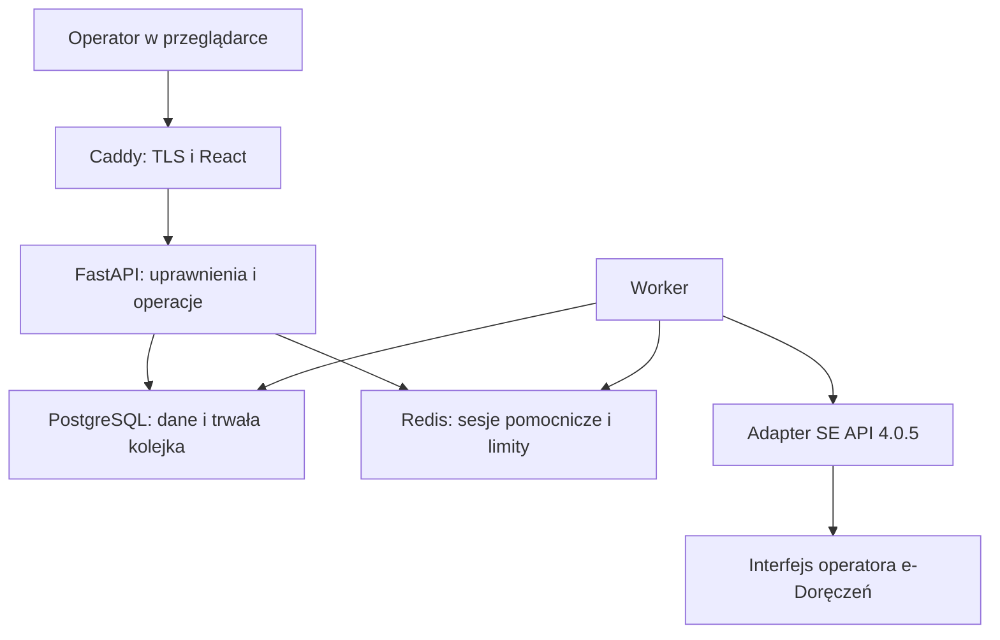

# Architektura

## Przepływ

Upload przechodzi przez limit proxy i backendu. Parser czyta CSV i JSON iteracyjnie, zapisując zaszyfrowane wiersze w partiach 500 w ramach transakcji importu. Niepowodzenie nie pozostawia częściowo gotowego importu. Przetwarzanie działa w wątku żądania FastAPI, więc nie blokuje pętli zdarzeń; operator czeka na zakończenie importu. Nie jest to osobna kolejka uploadów z procentowym postępem parsowania. Zerwanie żądania przed potwierdzeniem importu należy zweryfikować w historii zadań, aby nie tworzyć przypadkowo kolejnego identycznego zadania.

Mapowanie jest zatwierdzane osobno. Kanoniczne dane są zapisywane dla każdego wiersza; odrębny `Search` reprezentuje unikalny zestaw kryteriów w danym zadaniu. ID źródłowe nie jest częścią odcisku osoby, ale zawsze pochodzi z konkretnego wiersza w tabeli i eksporcie. Duplikaty nie są usuwane. Dwa różne adresy albo dwa różne warianty danych identyfikacyjnych nie są automatycznie uznawane za tę samą osobę.

Worker rezerwuje `Search` przy użyciu blokady transakcyjnej PostgreSQL `FOR UPDATE SKIP LOCKED`. Następnie uzyskuje globalny slot i tempo w Redisie, wykonuje wyszukiwanie, zapisuje wynik oraz historię próby i zwalnia slot. API nie wykonuje długiego masowego sprawdzania w żądaniu HTTP. Postęp jest odczytywany przez SSE; lista zadań jest odświeżana okresowo.

Sesja aplikacji jest losowym tokenem w ciasteczku; baza przechowuje jego HMAC i czas wygaśnięcia. Redis nie przechowuje pełnych danych osobowych. Tokeny BAE i robocze sekrety aktywacji TOTP w Redisie są zaszyfrowane. Ograniczenie sesji: 8 godzin, bez automatycznego przedłużania przy każdej operacji.

## Moduły

| Plik | Odpowiedzialność |
|---|---|
| `backend/app/adapter.py` | Kontrakt, autoryzacja, połączenie z OW i interpretacja odpowiedzi |
| `backend/app/worker.py` | Rezerwacje, wznowienie, retry, limity i retencja |
| `backend/app/importer.py` | Parsery, mapowanie, oryginalne wiersze i deduplikacja |
| `backend/app/validation.py` | PESEL, kompletność i normalizacja Unicode |
| `backend/app/security.py` | Szyfrowanie, HMAC, sesje, MFA, hasła i LDAPS |
| `backend/app/exporter.py` | CSV/JSON/XLSX i zbiorczy PDF |
| `backend/app/api.py` | Uprawnione operacje HTTP i SSE |
| `backend/app/db.py` | Modele trwałe, transakcje i audyt |
| `frontend/src/main.tsx` | Pulpit, formularze, tabela, historia i administracja |

## Statusy

`found` oznacza jedno dopasowanie z aktywnym i ujawnionym ADE, aktualnym rekordem i zgodnymi danymi identyfikacyjnymi, bez ostrzeżeń dostawcy. To kandydat do oceny kanału doręczenia. `not_found` wymaga poprawnej odpowiedzi zawierającej `totalResults=0` i pustą listę wyników. Brak pola, uszkodzony JSON ani awaria nie tworzą tego statusu.

`ambiguous` obejmuje wiele dopasowań, ostrzeżenia, nieaktualne lub nieaktywne ADE i rozbieżne dane. `invalid` oznacza błąd lokalnej walidacji albo odrzucenie zapytania 400. `technical_error` i `unauthorized` pozostają osobnymi wynikami. Niesprawdzone dane mają stan `pending` lub `running`. Ręczna flaga kontroli nie usuwa rzeczywistego statusu API; zmienia grupowanie raportu.

Model nie obejmuje nadawania wiadomości ani automatycznej decyzji PURDE/PUH. Nie wyciąga wniosków prawnych wyłącznie z braku dopasowania.

## Granice

Dane osobowe są zaszyfrowane na poziomie aplikacji. Indeksy HMAC umożliwiają równościowe wyszukiwanie bez jawnej kopii PESEL i nazwisk. Z tego powodu nie ma SQL `LIKE` po nazwiskach ani sortowania alfabetycznego całej bazy. Takie funkcje wymagałyby innego, świadomie przyjętego modelu ochrony indeksów.

Zmiana nowej głównej wersji SE API wymaga nowego adaptera, a nie przebudowy importera czy UI. Pełna historia prób jest w osobnej zaszyfrowanej tabeli i dostępna przez uprawnione `GET /api/jobs/{id}/attempts`. Dziennik technicznych operacji pozostaje oddzielny i nie zawiera danych zapytań.
